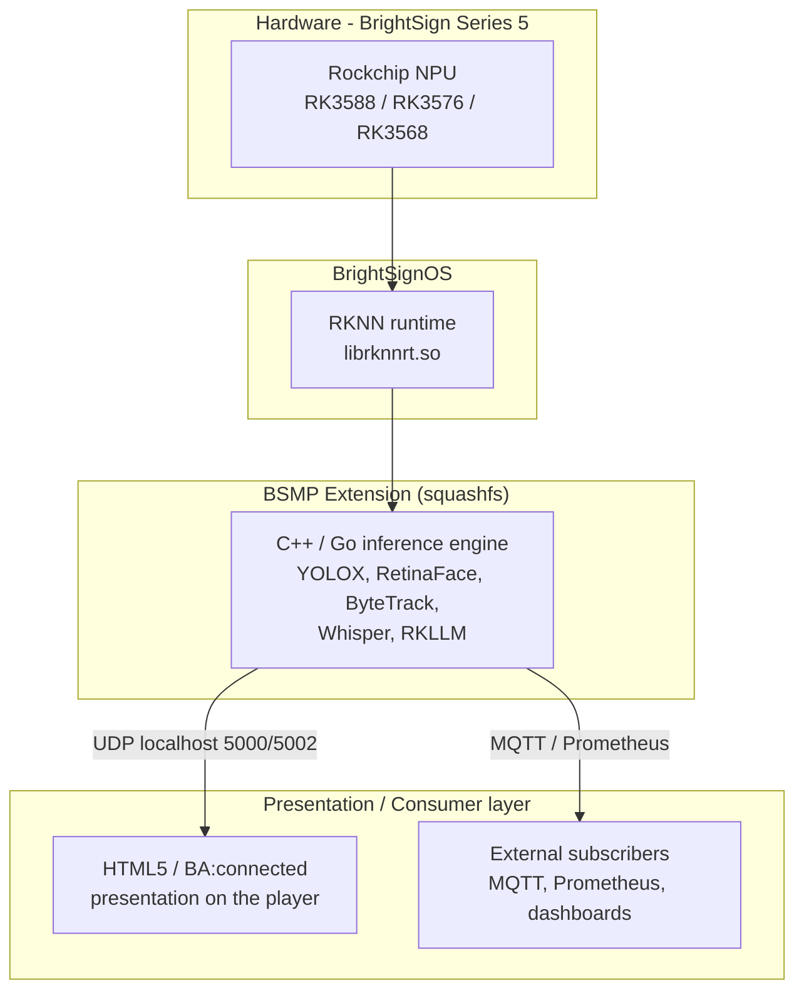

# BrightSign NPU: Capabilities and Systems Overview

On-device AI/ML on BrightSign Series 5 players. This repository is the conceptual
entry point for the BrightSign NPU ecosystem: what the hardware can do, how the
software stack is assembled, how models become installable extensions, and where to
find the published example projects that demonstrate each capability.

BrightSign Series 5 players are built on Rockchip SoCs that include a Neural
Processing Unit (NPU). The NPU runs machine-learning inference locally on the
player -- no cloud round-trip -- which gives low latency, viewer privacy (video
never leaves the device), and no per-inference bandwidth cost. Models are packaged
as **BrightSign Model Packages (BSMP)** and delivered as BrightSignOS extensions.

> **Looking for a complete solution?**
> [**Argus**](https://github.com/brightsign/argus-audience-measurement-extension) is
> BrightSign's reference audience-measurement application: person counting, gaze
> detection, dwell time, entry/exit events, and movement analytics, published over
> MQTT and Prometheus. The single-model extensions below are building blocks; Argus
> is the complete reference application. **Start with Argus.**

> Status note: Most example projects are reference material at ALPHA or BETA
> quality, intended to show how the stack fits together rather than for production
> deployment. Each repository states its own maturity.

## Start here

| If you want to... | Read |
| --- | --- |
| Use the complete reference application | [Argus audience measurement](https://github.com/brightsign/argus-audience-measurement-extension) |
| Understand what an NPU is and why it matters | [What is an NPU?](#what-is-an-npu) (below) |
| See how the whole stack fits together | [docs/architecture.md](docs/architecture.md) |
| Know what the NPU can actually do today | [docs/capabilities.md](docs/capabilities.md) |
| Find a specific example to clone | [docs/examples.md](docs/examples.md) |
| Learn how models become installable extensions | [docs/build-and-deploy.md](docs/build-and-deploy.md) |
| Build your own extension from a starting point | [extension-template](https://github.com/BrightDevelopers/extension-template) |
| Check model licensing before you ship | [model-licenses.md](model-licenses.md) · [AGPL-Applicablity.md](AGPL-Applicablity.md) |

## The stack in one picture



## What is an NPU?

A Neural Processing Unit (NPU) is a specialized hardware accelerator designed to
efficiently execute machine-learning and AI tasks. Unlike general-purpose CPUs or
GPUs, NPUs are optimized for the operations that dominate neural networks -- matrix
multiplications and convolutions -- so they run real-time inference faster and at
much lower power.

NPUs are well-suited for edge computing, where models run locally on the device
instead of in the cloud. On a BrightSign player this means low latency, viewer
privacy (frames never leave the device), and no per-inference bandwidth cost.

For deeper technical background, see the
[Rockchip NPU wiki](https://opensource.rock-chips.com/wiki_NPU), the
[Rockchip RKNN Toolkit](https://github.com/airockchip/rknn-toolkit2), and the
[Rockchip RKNN model zoo](https://github.com/airockchip/rknn_model_zoo).

## What the NPU does today

- **Machine vision** -- object detection (YOLOX, 80 COCO classes), face and gaze /
  attention detection (RetinaFace), multi-person tracking with stable IDs
  (ByteTrack), audience measurement (dwell, direction, entry/exit), multi-camera
  RTSP analytics, and license-plate recognition (design stage).
- **Audio** -- on-device speech-to-text (Whisper), gated by gaze so only an
  attending viewer's speech is transcribed.
- **Natural language** -- on-device LLM text generation (Qwen2.5 via RKLLM, design
  stage).
- **Developer platforms** -- a full Python CV/DL environment and a Docker runtime,
  both with NPU passthrough, for building your own workloads on the player.
- **Observability** -- Prometheus exporters for NPU telemetry and for analytics
  metrics.

See [docs/capabilities.md](docs/capabilities.md) for the model-by-model and
player-by-player detail, including the SoC support matrix and maturity labels.

## Published examples

The projects below are public on GitHub. The full catalog -- including internal
projects and design documents -- is in [docs/examples.md](docs/examples.md).

### Model packages (BSMP extensions)

Start with **Argus**, the complete reference application. The others are
single-model building blocks, useful when you want to understand or reuse one piece
in isolation.

| Project | Capability | Published |
| --- | --- | --- |
| [argus-audience-measurement-extension](https://github.com/brightsign/argus-audience-measurement-extension) | **Complete reference app** -- audience analytics: count, track, gaze, dwell, direction (YOLOX + RetinaFace + ByteTrack) | [Releases](https://github.com/brightsign/argus-audience-measurement-extension/releases/latest) |
| [argus-rtsp-watcher](https://github.com/brightsign/argus-rtsp-watcher) | Multi-camera (up to 8 RTSP) audience analytics | [Releases](https://github.com/brightsign/argus-rtsp-watcher/releases/latest) |
| [brightsign-npu-gaze-extension](https://github.com/brightsign/brightsign-npu-gaze-extension) | Face + gaze / attention detection (RetinaFace) | [Releases](https://github.com/brightsign/brightsign-npu-gaze-extension/releases/latest) |
| [brightsign-npu-object-extension](https://github.com/brightsign/brightsign-npu-object-extension) | Object detection, 80 COCO classes (YOLOX) | [Releases](https://github.com/brightsign/brightsign-npu-object-extension/releases/latest) |
| [brightsign-npu-voice-extension](https://github.com/brightsign/brightsign-npu-voice-extension) | Gaze-gated speech-to-text (RetinaFace + Whisper) | [Releases](https://github.com/brightsign/brightsign-npu-voice-extension/releases/latest) |

### Presentations and demo apps

| Project | What it shows |
| --- | --- |
| [simple-gaze-detection-html](https://github.com/brightsign/simple-gaze-detection-html) | Minimal HTML5 app consuming gaze UDP output |
| [simple-gaze-detection-presentation](https://github.com/brightsign/simple-gaze-detection-presentation) | BrightAuthor:connected presentation driven by gaze |
| [simple-object-detection-presentation](https://github.com/brightsign/simple-object-detection-presentation) | BrightAuthor:connected presentation for object detection |
| [simple-voice-detection-html](https://github.com/brightsign/simple-voice-detection-html) | HTML5 demo app for the voice BSMP |
| [argus-attention-demo-html](https://github.com/brightsign/argus-attention-demo-html) | HTML signage app with picture-in-picture "what the AI sees" |

### Developer platforms and tools

| Project | What it provides |
| --- | --- |
| [python-cv-dev-extension](https://github.com/brightsign/python-cv-dev-extension) | Python 3.8 + OpenCV + PyTorch + RKNN dev environment on the player |
| [extension-template](https://github.com/BrightDevelopers/extension-template) | Starting point for building your own BSMP extension |
| [bs-image-stream-server](https://github.com/brightsign/bs-image-stream-server) | Serves the decorated inference image for visual debugging |

## The repository family

A flat index of every repository in the ecosystem and its role. See
[docs/examples.md](docs/examples.md) for the annotated catalog, including internal
projects and design documents.

| Repository | Role |
| --- | --- |
| [argus-audience-measurement-extension](https://github.com/brightsign/argus-audience-measurement-extension) | Complete audience-measurement application -- **start here** |
| [argus-rtsp-watcher](https://github.com/brightsign/argus-rtsp-watcher) | Multi-camera RTSP audience analytics built on Argus |
| [brightsign-npu-general](https://github.com/brightsign/brightsign-npu-general) | This repository: concepts, use cases, architecture, model licensing |
| [brightsign-npu-gaze-extension](https://github.com/brightsign/brightsign-npu-gaze-extension) | Single-model BSMP: gaze detection |
| [brightsign-npu-object-extension](https://github.com/brightsign/brightsign-npu-object-extension) | Single-model BSMP: object detection |
| [brightsign-npu-voice-extension](https://github.com/brightsign/brightsign-npu-voice-extension) | Two-model BSMP: gaze-triggered speech-to-text |
| [simple-gaze-detection-html](https://github.com/brightsign/simple-gaze-detection-html) | HTML5 demo app for the gaze BSMP |
| [simple-voice-detection-html](https://github.com/brightsign/simple-voice-detection-html) | HTML5 demo app for the voice BSMP |
| [simple-gaze-detection-presentation](https://github.com/brightsign/simple-gaze-detection-presentation) | BrightAuthor:connected demo for the gaze BSMP |
| [simple-object-detection-presentation](https://github.com/brightsign/simple-object-detection-presentation) | BrightAuthor:connected demo for the object BSMP |
| [argus-attention-demo-html](https://github.com/brightsign/argus-attention-demo-html) | HTML signage demo for the Argus extension |
| [bs-image-stream-server](https://github.com/brightsign/bs-image-stream-server) | Dev tool: browser view of annotated model output |
| [extension-template](https://github.com/BrightDevelopers/extension-template) | Starter template for any BrightSign extension |
| [bs-workshop-extension](https://github.com/BrightDevelopers/bs-workshop-extension) | Hands-on workshop: build, package, deploy, iterate |
| [bs-extension-workshop-html-app](https://github.com/BrightDevelopers/bs-extension-workshop-html-app) | Companion HTML app for the workshop |
| [howto-git](https://github.com/brightsign/howto-git) | GitHub for non-coders -- for document collaborators |

### A note on GitHub organizations

Shipping model packages, demos, and tools live under
[`brightsign`](https://github.com/brightsign). Developer education material -- the
extension template and the workshop -- lives under
[`BrightDevelopers`](https://github.com/BrightDevelopers). The `BrightSign-Playground`
organization is retired; links to it survive only as redirects and should not be used.

## Model licensing

Any BSMP must include one or more models, and using a model from the
[Rockchip model zoo](https://github.com/airockchip/rknn_model_zoo) links that
model's license to your package. The licensing split matters for commercial
deployment:

- **Apache 2.0 / MIT** -- permissive; allows commercial and closed-source use with
  attribution. Examples: YOLOX, RetinaFace, Whisper, ResNet-50, MobileNet.
- **GPL 3.0** -- strong copyleft; derivative works must be open-sourced. Examples:
  YOLOv5/v6/v7.
- **AGPL 3.0** -- extends GPL to network use (SaaS); even server-side use can
  trigger the source-disclosure obligation. Examples: YOLOv8/v10/v11.
- **CC BY-NC 4.0** -- non-commercial use only. Example: MMS-TTS.

The example extensions themselves are Apache 2.0, but `librknnrt.so` and bundled
models carry their own terms. For the full model-by-model table and a focused
treatment of the AGPL question, see:

- [model-licenses.md](model-licenses.md) -- license and commercial-use table for the
  Rockchip model zoo.
- [AGPL-Applicablity.md](AGPL-Applicablity.md) -- what AGPL does and does not require
  when you run, modify, or embed a model.

**Disclaimer**: always verify licensing terms and consult legal advice if necessary.

## Project structure

```
brightsign-npu-general/
├── README.md                  # this file -- the ecosystem hub
├── model-licenses.md          # Rockchip model-zoo license table
├── AGPL-Applicablity.md       # AGPL applicability to AI model use
└── docs/
    ├── architecture.md        # hardware, runtime, build pipeline, data flow
    ├── capabilities.md        # models, use cases, player/SoC support matrix
    ├── examples.md            # full catalog of every repo, with links
    └── build-and-deploy.md    # SDK -> build cache -> extension -> player
```

## Key concepts

- **NPU** -- the Rockchip neural accelerator on the SoC; runs matrix / convolution
  operations far more efficiently than the CPU or GPU.
- **RKNN** -- Rockchip's runtime (`librknnrt.so`) and toolkit. Models are converted
  from ONNX to the `.rknn` format with `rknn-toolkit2` before they can run on the NPU.
- **BSMP** -- BrightSign Model Package: a model plus the inference engine that drives
  it, delivered as an extension.
- **Extension** -- a BrightSignOS firmware add-on implemented as a Linux squashfs
  filesystem. Dev builds ship as a volatile LVM extension zip; production builds ship
  as a signed `.bsfw` installed at reboot.
- **UDP contract** -- extensions publish results on localhost UDP: port 5000 for
  BrightScript-friendly text, port 5002 for JSON. Presentations subscribe to these.

## References

- [Rockchip NPU wiki](https://opensource.rock-chips.com/wiki_NPU)
- [Rockchip RKNN Toolkit](https://github.com/airockchip/rknn-toolkit2)
- [Rockchip RKNN model zoo](https://github.com/airockchip/rknn_model_zoo)
- [extension-template](https://github.com/BrightDevelopers/extension-template) -- build
  your own BSMP extension
