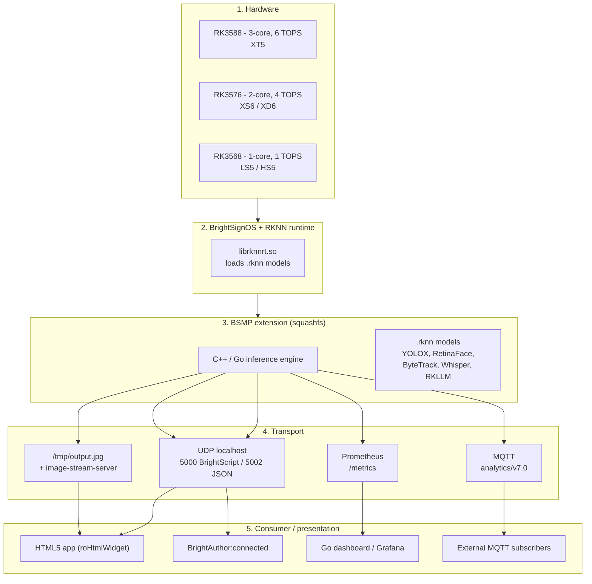
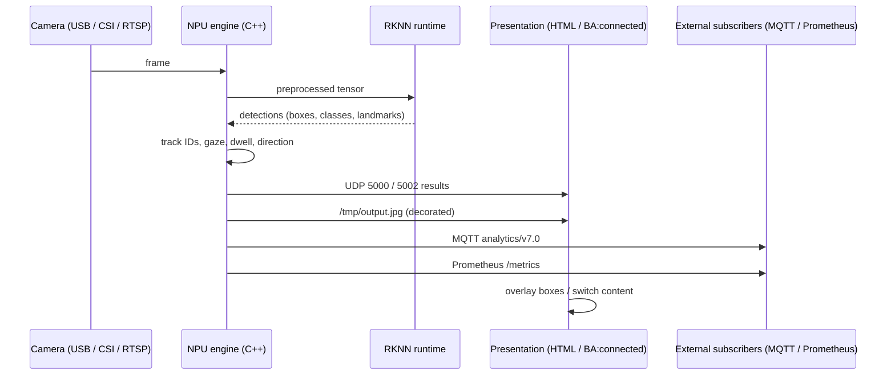
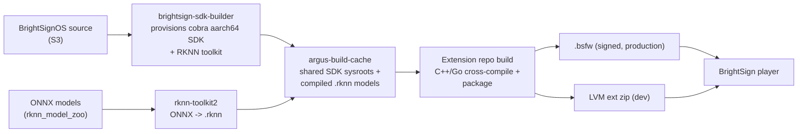
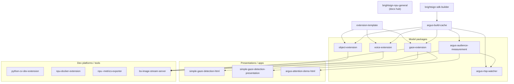

# Architecture

How on-device AI runs on a BrightSign player, from silicon to presentation.

## Layers

### 1. Hardware

BrightSign Series 5 players use Rockchip SoCs with an integrated NPU. The NPU
accelerates the matrix multiplications and convolutions that dominate neural-network
inference, at much lower power than a CPU or GPU.

Per-SoC specs below are from the Argus extension READMEs (the current source of truth).

| SoC | NPU | Example players | Parallel models (Argus) |
| --- | --- | --- | --- |
| RK3588 | 3-core, 6 TOPS | XT5 | 2-3 models |
| RK3576 | 2-core, 4 TOPS | XS6 / XD6 (reported as "XS156") | 2 models |
| RK3568 | 1-core, 1 TOPS | LS5 / HS5 | 1 model |

Capacity scales with the NPU: the audience engine runs 2-3 models in parallel on an
XT5 but only 1 on an LS5/HS5. Feature coverage also varies by SoC -- the voice
extension and the LLM design currently target RK3588 (XT5) only.

### 2. BrightSignOS and the RKNN runtime

Inference uses Rockchip's RKNN runtime, `librknnrt.so`, shipped with BrightSignOS.
Models must be in Rockchip's `.rknn` format; they are compiled ahead of time from
ONNX with `rknn-toolkit2` (see [build-and-deploy.md](build-and-deploy.md)). LLM
workloads use the separate RKLLM runtime.

The Python CV extension requires BrightSignOS 9.1.79.3 or newer for its bundled
`librknnrt.so`.

### 3. The BSMP extension

A BrightSign Model Package bundles one or more `.rknn` models with the engine that
runs them. It is delivered as a BrightSignOS **extension**: a Linux squashfs
filesystem that extends the firmware and auto-starts at boot via `bsext_init`.

Engines are written in C++ (the inference pipelines) and, in the Argus family, Go
(supervisors, dashboards, and MQTT/metrics services). A typical vision engine uses a
producer-consumer threading model: one thread pulls camera frames, another runs NPU
inference, a third formats and publishes results.

### 4. Transport

Extensions do not render UI. They publish results, and separate consumers subscribe.

| Channel | Default | Payload | Consumed by |
| --- | --- | --- | --- |
| UDP localhost | 5000 | BrightScript-friendly text | `autorun.brs`, BA:connected |
| UDP localhost | 5002 | JSON | HTML5 presentations |
| MQTT (Argus) | 1883 (TCP), 9001 (WebSockets) | `analytics/v7.0` JSON | external subscribers, dashboard |
| Prometheus | 9101 (Argus) / 9400 (NPU exporter) | metrics exposition | Prometheus / Grafana |
| Image | `/tmp/output.jpg` + port 20200 | decorated JPEG | presentations, visual debug |
| Dashboard | 20300 | HTML "mission control" / zone config | browser |
| Health (rtsp-watcher) | 9200 `/healthz` | per-stream state / capacity | operators |

Ports vary by project; the project README is authoritative. The gaze/object/voice
extensions use the UDP 5000/5002 contract; the Argus family uses MQTT + Prometheus
instead. `argus-rtsp-watcher` serves per-stream MJPEG at `20200 + stream index`. Some
design documents (LPR, LLM) use 5001/5003 instead of 5000/5002.

### 5. Consumer / presentation

The visible experience runs in one of:

- An **HTML5 app** in `roHtmlWidget`, launched by `autorun.brs`, that polls
  `/tmp/output.jpg` and listens on a UDP port to overlay results or switch content.
- A **BrightAuthor:connected** presentation that switches content based on the UDP
  values (for example, play a different video when one vs. more than one person looks
  at the screen).
- A **dashboard** -- the Argus Go `dashboard-server`, or an external Prometheus /
  Grafana stack -- for analytics and operations.

## Runtime data flow

## Build pipeline

Example repos share one cross-compilation pipeline so the heavy toolchain and model
assets are built once and reused.

- **brightsign-sdk-builder** provisions a build host once with the aarch64
  cross-compile SDK and the RKNN toolkit, driven by a Makefile and Yocto /
  OpenEmbedded recipes.
- **argus-build-cache** holds the shared, box-level assets: compiled SDK sysroots and
  per-SoC `.rknn` models (YOLOX, RetinaFace, Whisper, a MobileNetV2 embedding, an
  RKLLM Qwen2.5 model, and a Piper TTS runtime). Consumer repos point at it with
  `BS_CACHE_DIR` / `ARGUS_CACHE_DIR` (default `../argus-build-cache`).
- Each **extension repo** cross-compiles its engine against the cache, compiles or
  reuses the needed models, and packages a `.bsfw` (production) and an LVM extension
  zip (dev).

The three model extensions (gaze, object, voice) follow an identical sequence:
`./setup` -> `./compile-models` -> `./build --extract-sdk` -> `./build-apps` ->
`./package`. Full detail in [build-and-deploy.md](build-and-deploy.md).

## Repository ecosystem

Argus is the most complete family: `argus-audience-measurement-extension` is the core
engine, `argus-rtsp-watcher` reuses it for multiple RTSP cameras, and the HTML demos
are its signage front-ends.

## Design decisions worth knowing

- **Privacy by design.** Vision engines process frames on-device and publish only
  derived metrics (counts, gaze, dwell). No images leave the player, and the audience
  engine does no facial recognition.
- **Separation of inference and presentation.** The UDP/MQTT contract lets the same
  BSMP drive an HTML app, a BA:connected presentation, or an external dashboard
  without changing the engine.
- **Shared build cache.** Cross-compiling the SDK and models is expensive; building
  once and sharing via `argus-build-cache` keeps per-project builds fast.
