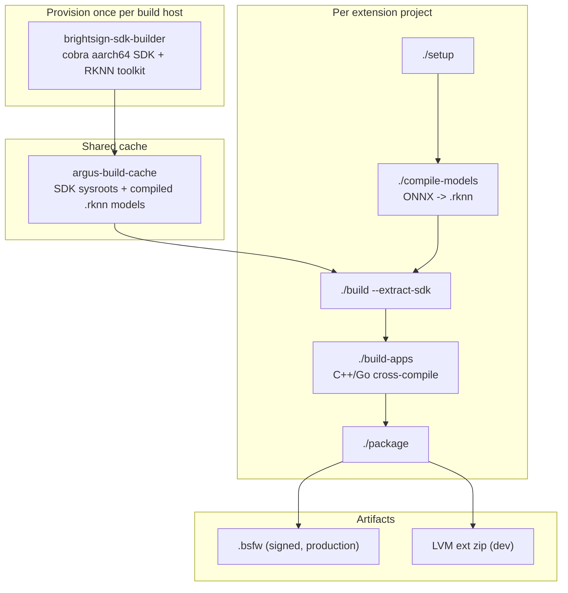
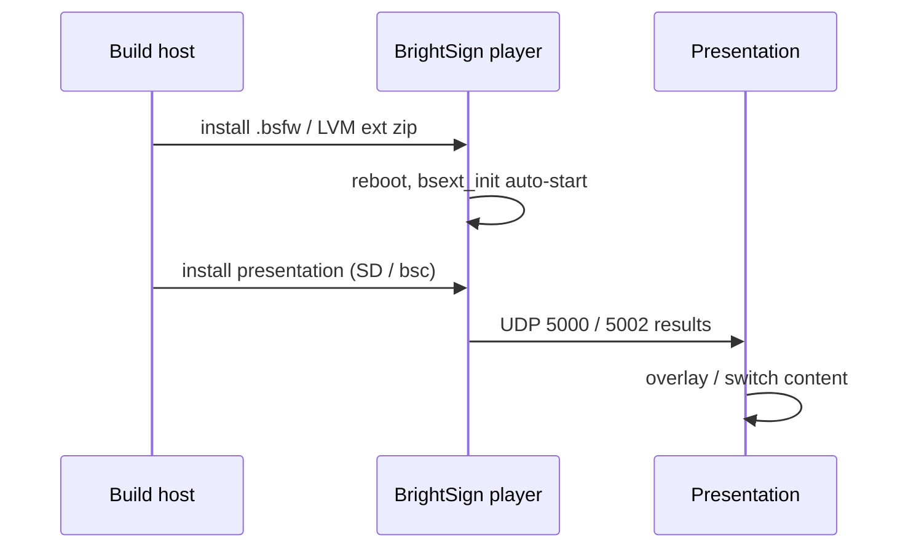

# Build and Deploy

How a model becomes an extension installed on a player. This describes the shared
pattern used by the example repos; each repo's README has the exact commands.

## The pipeline

## Stage 1: provision the SDK (once per host)

`brightsign-sdk-builder` builds the heavy, reusable toolchain: the aarch64
cross-compile SDK ("cobra" toolchain) and the RKNN toolkit, using BrightSignOS source
and Yocto / OpenEmbedded recipes. Run it once per build machine. It is Makefile-driven
and configurable by `BRIGHTSIGN_OS_VERSION`.

Output lands in the shared cache, by default `../argus-build-cache`
(`ARGUS_CACHE_DIR` / `BS_CACHE_DIR`).

## Stage 2: the shared build cache

`argus-build-cache` holds box-level assets reused across projects so they are built
once:

- Compiled SDK sysroots
- Per-SoC `.rknn` models (RK3568 / RK3576 / RK3588): `yolox_s`, `RetinaFace`,
  `whisper_encoder/decoder_base.en`, `mobilenetv2-embedding`, COCO labels
- An RKLLM LLM (`qwen2.5-1.5b-instruct.rkllm`)
- A Piper TTS runtime (espeak-ng, onnxruntime, piper_phonemize)

## Stage 3: compile models (ONNX to RKNN)

Models cannot run on the NPU as ONNX. `rknn-toolkit2` converts ONNX to the `.rknn`
format, quantizing to INT8 or FP16 with a calibration dataset. Source models typically
come from the [Rockchip model zoo](https://github.com/airockchip/rknn_model_zoo).

In the gaze/object/voice extensions this is `./compile-models`. The result is cached
so later builds skip it.

## Stage 4: build the engine

`./build --extract-sdk` extracts the cached SDK; `./build-apps` cross-compiles the C++
inference engine (and, for Argus, the Go supervisor / dashboard / MQTT services) for
ARM64. Builds use CMake and typically run in a Docker container for a reproducible
toolchain.

## Stage 5: package

Packaging produces more than one artifact. In the Argus family, `make package`
produces two zips, and the GitHub release additionally carries a standalone `.bsfw`:

| Artifact | Example name | Use | Properties |
| --- | --- | --- | --- |
| Dev zip | `argus-dev-<ts>.zip` | development | unzip to `/usr/local/argus` and run; volatile, lost on reboot |
| LVM extension zip | `argus-ext-<ts>.zip` | production | installs into the extension partition; survives reboots and SD removal |
| Standalone `.bsfw` | `cobra-standalone-npu_argus-<ver>.bsfw` | production | signed firmware; applied automatically from the SD-card root at boot |

The gaze, object, and voice extensions publish primarily the `.bsfw`; the Argus
extensions publish both the LVM ext zip and a `.bsfw`.

## Deploy to a player

1. Copy the artifact to the player (SD card, or the player's file transfer / `bsc`
   CLI).
2. Install: a `.bsfw` dropped at the SD-card root is applied automatically at boot; an
   LVM extension zip is installed with the project's `ext_*_install-lvm.sh` script
   (the generated `install-on-player.sh` helper runs this for you).
3. The extension auto-starts at boot via `bsext_init`.
4. It publishes results on UDP (5000 BrightScript / 5002 JSON), and, for Argus, on
   MQTT and Prometheus.
5. Deploy a presentation (HTML5 app or BrightAuthor:connected) that subscribes to
   those results. The presentation and the extension are separate installs.

## Reference points

- Required BrightSignOS: varies by project (for example, the Python CV extension needs
  9.1.79.3+ for its `librknnrt.so`).
- Visual debugging: install
  [bs-image-stream-server](https://github.com/brightsign/bs-image-stream-server) and
  open port 20200 to see the decorated inference image.
- Build the simplest possible extension first with
  [extension-template](https://github.com/BrightDevelopers/extension-template) before adding
  a model.
