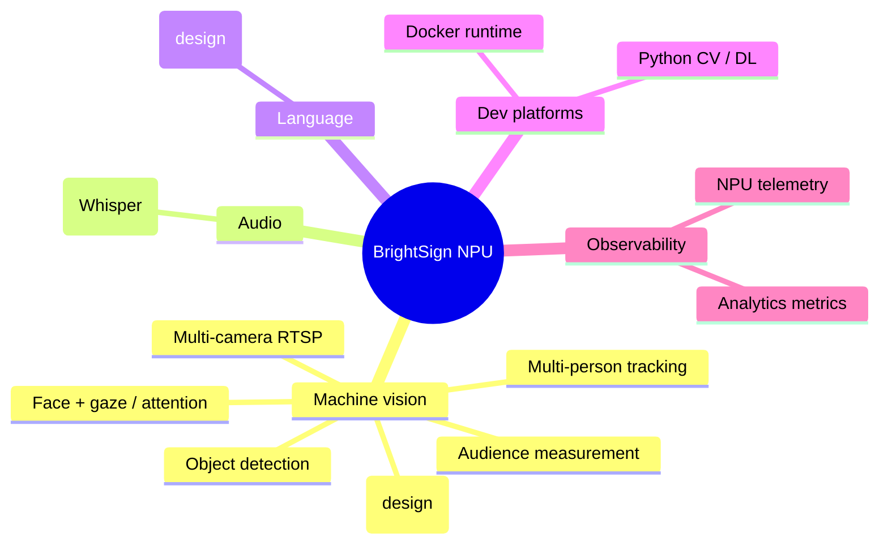

# Capabilities

What the BrightSign NPU can do today, by capability, with the models and players
involved. Maturity labels come from each project's own README.

## Summary

## Machine vision

### Object detection

Real-time detection of the 80 COCO classes with per-class selection and tunable
confidence. Runs at roughly 30 FPS. Emits bounding boxes, a decorated image, and
JSON.

- **Model:** YOLOX (nano through xl)
- **Player/SoC:** RK3588 (XT-5), RK3576, RK3568
- **Example:** [brightsign-npu-object-extension](https://github.com/brightsign/brightsign-npu-object-extension) -- ALPHA

### Face and gaze / attention detection

Detects faces and determines whether each is looking at the screen. Reports faces in
frame and faces attending; draws green boxes (looking) and red boxes (not looking).

- **Model:** RetinaFace
- **Player/SoC:** RK3588 (XT-5), RK3576, RK3568
- **Example:** [brightsign-npu-gaze-extension](https://github.com/brightsign/brightsign-npu-gaze-extension) -- BETA
- **Front-ends:** [simple-gaze-detection-html](https://github.com/brightsign/simple-gaze-detection-html),
  [simple-gaze-detection-presentation](https://github.com/brightsign/simple-gaze-detection-presentation)

### Audience measurement

The most complete vision application. Counts people, assigns stable track IDs,
measures gaze and gaze time, dwell time, entry/exit, 8-way movement direction and
speed. Privacy-preserving: no images leave the device, no facial recognition.

- **Models:** YOLOX (person) + RetinaFace (face/gaze) on the NPU, plus ByteTrack
  (CPU-side tracker). The build compiles two `.rknn` models per SoC; ByteTrack is not
  an NPU model.
- **Outputs:** MQTT (`bs/argus/analytics`, schema `analytics/v7.0`, broker on `:1883`,
  WebSockets on `:9001`), Prometheus (`:9101/metrics`), Go dashboard (`:20300`), image
  stream (`:20200`)
- **Player/SoC:** RK3588, RK3576, RK3568 (parallel-model capacity scales 2-3 / 2 / 1)
- **Performance:** 25-30 FPS, <15 ms inference per model, 35-55 ms end-to-end, ~3.5 W
  (fanless)
- **Status:** BETA -- the `analytics/v7.0` schema and `argus_*` metric names are stable
- **Example:** [argus-audience-measurement-extension](https://github.com/brightsign/argus-audience-measurement-extension)

### Multi-camera RTSP analytics

Runs the audience pipeline on multiple simultaneous RTSP streams from one player, with
per-camera zones of interest, at ~5-10 FPS per stream. Stream capacity scales with the
SoC: up to 8 on XT5 (RK3588), 4 on XS6/XD6 (RK3576), 1 on LS5/HS5 (RK3568).

- **Architecture:** Go supervisor spawning one C++ engine per stream; per-stream MQTT
  (`bs/argus/<id>/analytics`); bundled mosquitto (`:1883`) and optional MediaMTX RTSP
  proxy; per-stream MJPEG preview at `20200 + index`; health at `:9200/healthz`; zone
  dashboard at `:20300`.
- **Example:** [argus-rtsp-watcher](https://github.com/brightsign/argus-rtsp-watcher)

### License-plate recognition (design stage)

Two-stage ALPR: detect the plate, then read the characters, with regional format
validation (US/EU/CN).

- **Models:** YOLOv8n-plate (detection) + LPRNet with CTC decode (recognition)
- **Status:** Internal design document; implementation not yet published.

## Audio

### Speech-to-text

Transcribes speech on-device. Gated by gaze so only an attending viewer's speech is
transcribed -- a multimodal pipeline where RetinaFace attention gates the Whisper ASR
model. Both models run simultaneously on the NPU.

- **Models:** RetinaFace + Whisper (encoder-decoder)
- **Hardware:** USB camera + microphone; RK3588 (XT-5) only
- **Example:** [brightsign-npu-voice-extension](https://github.com/brightsign/brightsign-npu-voice-extension) -- ALPHA

## Natural language

### On-device LLM (design stage)

Local LLM text generation exposed to presentations over UDP. Targets roughly 0.8-1.3
tokens/sec on XT-5.

- **Model:** Qwen2.5-1.5B INT8 via RKLLM (alternatives considered: TinyLlama-1.1B,
  Phi-2)
- **Status:** Internal design document; a compiled `qwen2.5-1.5b-instruct.rkllm` and a
  Piper TTS runtime exist in the shared build cache.

## Developer platforms

### Python CV / DL environment

A full Python 3.8 computer-vision and deep-learning stack packaged as an extension:
OpenCV, PyTorch 2.4.1, ONNX, and the RKNN toolkit (`rknnlite.api.RKNNLite`). Ships an
NPU-accelerated YOLOX example (~10 ms/frame on NPU vs ~100 ms on CPU) and supports the
50+ models in the RKNN model zoo.

- **Player/SoC:** RK3588 (XT-5); needs BrightSignOS 9.1.79.3+
- **Example:** [python-cv-dev-extension](https://github.com/brightsign/python-cv-dev-extension) -- ALPHA

### Docker runtime with NPU passthrough

A full Docker CE container runtime on the player, with the NPU and DRI device passed
through so containerized workloads get hardware-accelerated inference (reported
~9-12x speedups for YOLOX-S, ResNet-50, MobileNet-V2).

- **Status:** Internal (brightsign-npu-docker-extension)

## Observability

| What | Metrics | Default port | Project |
| --- | --- | --- | --- |
| NPU telemetry | frequency, per-core utilization, driver version | 9400 | npu--metrics-exporter (internal) |
| Analytics | audience metrics in Prometheus format | 9101 | argus-audience-measurement-extension |

The NPU exporter reads Rockchip RKNPU debug sysfs nodes
(`/sys/kernel/debug/rknpu/freq`, `/load`, `/version`) and exposes them in Prometheus
exposition format.

## Model and SoC support matrix

| Capability | Models | RK3588 (XT-5) | RK3576 | RK3568 | Maturity |
| --- | --- | :---: | :---: | :---: | --- |
| Object detection | YOLOX | yes | yes | yes | ALPHA |
| Gaze / attention | RetinaFace | yes | yes | yes | BETA |
| Audience measurement | YOLOX + RetinaFace + ByteTrack | yes | yes | yes | BETA |
| Multi-camera RTSP | YOLOX + RetinaFace + ByteTrack | 8 streams | 4 streams | 1 stream | ALPHA |
| Speech-to-text | RetinaFace + Whisper | yes | - | - | ALPHA |
| License plate | YOLOv8 + LPRNet | design | design | design | design |
| On-device LLM | Qwen2.5-1.5B (RKLLM) | design | - | - | design |
| Python CV env | model-zoo (50+) | yes | - | - | ALPHA |

"yes" means the project targets that SoC per its README; a dash means not currently
targeted. Always confirm against the project README, which is authoritative.

## Model licensing

Models carry their own licenses, which matter for commercial deployment. YOLOX,
RetinaFace, YOLOv8-plate, and LPRNet from the Rockchip model zoo are generally Apache
2.0; some zoo models are GPL or AGPL. The example extensions themselves are Apache
2.0, but `librknnrt.so` and bundled models have their own terms.

See [model-licenses.md](../model-licenses.md) and
[AGPL-Applicablity.md](../AGPL-Applicablity.md) in this repository.
