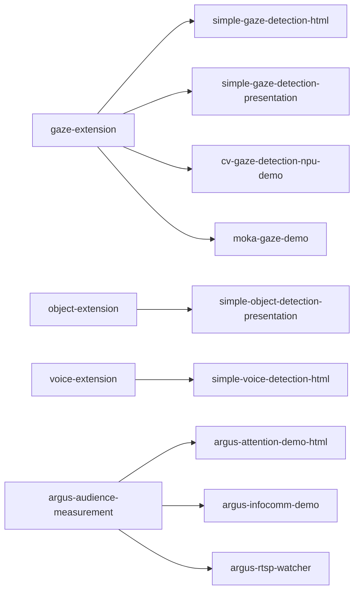

# Example Catalog

Every project in the BrightSign NPU ecosystem, grouped by role. "Published" means the
GitHub repository is public; "Internal" means it is private or a design document not
yet implemented. Links point to public repositories only.

## Documentation and templates

| Project | Role | Status |
| --- | --- | --- |
| [brightsign-npu-general](https://github.com/brightsign/brightsign-npu-general) | Conceptual entry point: NPU overview, BSMP/extension model, model licensing (**this repository**) | Published |
| [extension-template](https://github.com/BrightDevelopers/extension-template) | Starting point for building your own extension | Published |

## Model packages (BSMP extensions)

These install on a player and run inference on the NPU.

### brightsign-npu-gaze-extension -- Published (BETA)
Face and gaze/attention detection with RetinaFace. Counts faces in frame and faces
attending; supports USB cameras and RTSP (up to 2K) with auto-recovery. Outputs on
UDP 5000 (BrightScript) and 5002 (JSON).
- Repo: https://github.com/brightsign/brightsign-npu-gaze-extension
- Releases: https://github.com/brightsign/brightsign-npu-gaze-extension/releases/latest
- SoCs: RK3588 (XT-5), RK3568 (LS-5), RK3576
- Docs: [Design](https://github.com/brightsign/brightsign-npu-gaze-extension/blob/main/docs/DESIGN.md) ·
  [Development guide](https://github.com/brightsign/brightsign-npu-gaze-extension/blob/main/docs/development-guide.md) ·
  [Manifest guide](https://github.com/brightsign/brightsign-npu-gaze-extension/blob/main/docs/manifest-guide.md) ·
  [RTSP design](https://github.com/brightsign/brightsign-npu-gaze-extension/blob/main/docs/DESIGN-RTSP.md)

### brightsign-npu-object-extension -- Published (ALPHA)
YOLOX object detection over the 80 COCO classes at ~30 FPS, with per-class selection
and confidence tuning. Outputs `/tmp/output.jpg`, `/tmp/results.json`, and UDP
5000/5002. Includes a GitHub Actions build workflow.
- Repo: https://github.com/brightsign/brightsign-npu-object-extension
- Releases: https://github.com/brightsign/brightsign-npu-object-extension/releases/latest
- SoCs: RK3588, RK3568, RK3576
- Docs: [Software architecture](https://github.com/brightsign/brightsign-npu-object-extension/blob/main/docs/software-architecture.md) ·
  [Integration & extension points](https://github.com/brightsign/brightsign-npu-object-extension/blob/main/docs/integration-extension-points.md) ·
  [Manifest guide](https://github.com/brightsign/brightsign-npu-object-extension/blob/main/docs/manifest-guide.md)

### brightsign-npu-voice-extension -- Published (ALPHA)
Gaze-gated speech-to-text: RetinaFace attention gates a Whisper ASR model, both
running on the NPU simultaneously. UDP 5000 includes an `ASR` field; UDP 5002 is JSON.
Requires USB camera + microphone.
- Repo: https://github.com/brightsign/brightsign-npu-voice-extension
- Releases: https://github.com/brightsign/brightsign-npu-voice-extension/releases/latest
- SoC: RK3588 (XT-5) only
- Docs: [Design](https://github.com/brightsign/brightsign-npu-voice-extension/blob/main/docs/DESIGN.md)

### argus-audience-measurement-extension -- Published (BETA)
The flagship audience-analytics engine. Person counting, stable per-person tracking,
gaze and gaze time, dwell, entry/exit, 8-way direction and speed. C++ engine with an
embedded Go dashboard server. Outputs MQTT (`bs/argus/analytics`, `analytics/v7.0`,
broker `:1883`, WebSockets `:9001`), Prometheus (`:9101/metrics`), a mission-control
dashboard (`:20300`), and an image stream (`:20200`). The schema and `argus_*` metric
names are declared stable.
- Repo: https://github.com/brightsign/argus-audience-measurement-extension
- Releases: https://github.com/brightsign/argus-audience-measurement-extension/releases/latest (v0.7.0)
- Release artifacts: `cobra-standalone-npu_argus-<ver>.bsfw` (standalone) and `argus-ext-<ts>.zip` (LVM extension)
- Models: YOLOX + RetinaFace (NPU) + ByteTrack (CPU tracker)
- SoCs: RK3588 / RK3576 / RK3568 (parallel-model capacity 2-3 / 2 / 1)
- Docs: [Configuration](https://github.com/brightsign/argus-audience-measurement-extension/blob/main/docs/CONFIGURATION.md) ·
  [MQTT integration](https://github.com/brightsign/argus-audience-measurement-extension/blob/main/docs/INTEGRATION-MQTT.md) ·
  [MQTT schema v7.0](https://github.com/brightsign/argus-audience-measurement-extension/blob/main/docs/mqtt-message-format.md) ·
  [Prometheus & Grafana](https://github.com/brightsign/argus-audience-measurement-extension/blob/main/docs/prometheus-grafana-setup.md) ·
  [Tracking explained](https://github.com/brightsign/argus-audience-measurement-extension/blob/main/docs/TRACKING-EXPLAINED.md) ·
  [Design](https://github.com/brightsign/argus-audience-measurement-extension/blob/main/docs/DESIGN.md) ·
  [Build instructions](https://github.com/brightsign/argus-audience-measurement-extension/blob/main/docs/BUILD-INSTRUCTIONS.md)

### argus-rtsp-watcher -- Published
Runs the Argus pipeline on multiple simultaneous RTSP streams from one player, with
per-camera zones of interest and live config hot-reload. Go supervisor spawning one
C++ engine per stream; bundled mosquitto (`:1883`) and optional MediaMTX proxy;
per-stream MQTT (`bs/argus/<id>/analytics`); per-stream MJPEG preview at `20200 +
index`; health at `:9200/healthz`; zone dashboard at `:20300`.
- Repo: https://github.com/brightsign/argus-rtsp-watcher
- Releases: https://github.com/brightsign/argus-rtsp-watcher/releases/latest (v0.1.2)
- Release artifacts: `cobra-standalone-npu_watch-<ver>.bsfw` and `npu-watch-<ver>.zip`
- SoCs: RK3588 / XT5 (up to 8 streams, primary target), RK3576 / XS6-XD6 (4 streams), RK3568 / LS5-HS5 (1 stream)
- Docs: [Vision](https://github.com/brightsign/argus-rtsp-watcher/blob/main/VISION.md) ·
  [Design](https://github.com/brightsign/argus-rtsp-watcher/blob/main/docs/DESIGN.md) ·
  [Bounding boxes & MQTT schema](https://github.com/brightsign/argus-rtsp-watcher/blob/main/docs/bounding-boxes.md) ·
  [MediaMTX / secure RTSP](https://github.com/brightsign/argus-rtsp-watcher/blob/main/docs/mediamtx-secure-rtsp.md) ·
  [Recording & sync](https://github.com/brightsign/argus-rtsp-watcher/blob/main/docs/recording-and-sync.md) ·
  [Hardware validation](https://github.com/brightsign/argus-rtsp-watcher/blob/main/docs/HARDWARE-VALIDATION.md) ·
  [Prerequisites](https://github.com/brightsign/argus-rtsp-watcher/blob/main/docs/PRE-REQS.md)

## Presentations and demo apps

These run on the player and visualize or react to a BSMP's output.

| Project | What it is | Pairs with | Status |
| --- | --- | --- | --- |
| [simple-gaze-detection-html](https://github.com/brightsign/simple-gaze-detection-html) | Minimal HTML5/JS app: full-motion video + picture-in-picture of what the camera AI sees, with a live UDP message feed | gaze extension | Published |
| [simple-gaze-detection-presentation](https://github.com/brightsign/simple-gaze-detection-presentation) | BrightAuthor:connected presentation; switches content by person count (attract loop / one looker / many lookers) | gaze extension | Published |
| [argus-attention-demo-html](https://github.com/brightsign/argus-attention-demo-html) | HTML signage app with picture-in-picture face boxes, driven by the Argus extension | argus extension | Published |
| simple-object-detection-presentation | BA:connected presentation for object detection | object extension | Published (referenced) |
| simple-voice-detection-html | HTML demo for the voice extension | voice extension | Published (referenced) |
| cv-gaze-detection-npu-demo | HTML/JS + Node signage demo visualizing gaze output | gaze extension | Internal |
| moka-gaze-demo | TypeScript smart-signage demo with a state machine and a Prometheus/Grafana monitoring stack | gaze extension | Internal |
| argus-infocomm-demo | InfoComm trade-show build of the attention HTML demo | argus extension | Internal |

## Developer platforms and tools

| Project | Role | Status |
| --- | --- | --- |
| [python-cv-dev-extension](https://github.com/brightsign/python-cv-dev-extension) | Python 3.8 + OpenCV + PyTorch + RKNN dev environment on the player | Published (ALPHA) |
| [bs-image-stream-server](https://github.com/brightsign/bs-image-stream-server) | Serves the decorated `/tmp/output.jpg` (default port 20200) for visual debugging | Published |
| brightsign-npu-docker-extension | Docker CE runtime with NPU passthrough for containerized workloads | Internal |
| npu--metrics-exporter | Prometheus exporter for NPU telemetry (frequency, utilization, driver); default port 9400 | Internal |
| brightsign-sdk-builder | Provisions a build host with the cross-compile SDK and RKNN toolkit | Internal |
| argus-build-cache | Shared build cache: compiled SDK sysroots and per-SoC `.rknn` models (local, no remote) | Internal |
| inference-results-udp-sender | Placeholder repo for a UDP results publisher; no content yet | Internal / empty |

`python-cv-dev-extension` docs:
[Getting started](https://github.com/brightsign/python-cv-dev-extension/blob/main/docs/getting-started.md) ·
[Build process](https://github.com/brightsign/python-cv-dev-extension/blob/main/docs/build-process.md) ·
[Deployment](https://github.com/brightsign/python-cv-dev-extension/blob/main/docs/deployment.md) ·
[Model zoo guide](https://github.com/brightsign/python-cv-dev-extension/blob/main/docs/model-zoo-guide.md) ·
[Troubleshooting](https://github.com/brightsign/python-cv-dev-extension/blob/main/docs/troubleshooting.md) ·
[ADRs](https://github.com/brightsign/python-cv-dev-extension/tree/main/docs/adr)

## Design documents (not yet implemented)

These repositories currently contain specifications rather than shipping code.

| Project | What it designs | Status |
| --- | --- | --- |
| npu-license-plate | ALPR pipeline: YOLOv8-plate detection + LPRNet recognition, UDP output | Internal design doc |
| npu-llm | On-device LLM (Qwen2.5-1.5B via RKLLM) exposed to presentations over UDP | Internal design doc |

## How the examples relate

A model extension provides inference; a presentation or demo app provides the visible
experience. Clone one of each that share a column above to see an end-to-end example.
